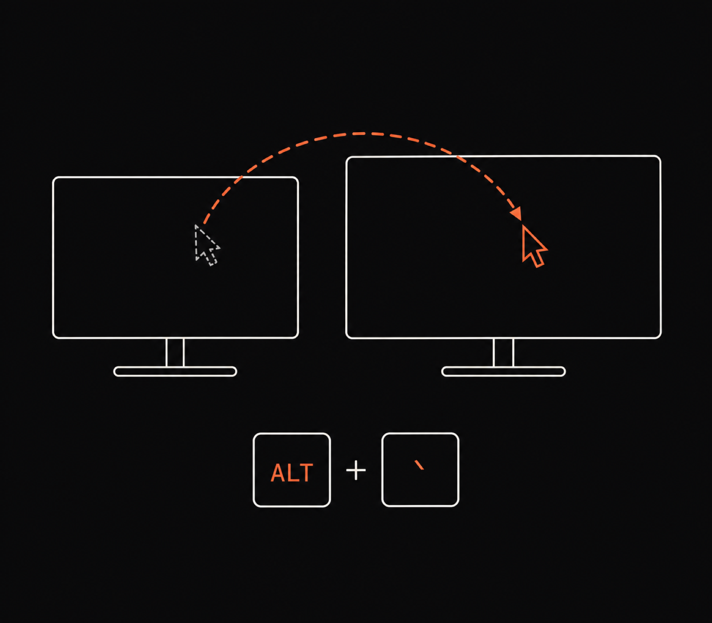

# Move Cursor Display



The modern professional is a nomad. On Monday one sits at a hot desk where the
external monitor stands to the left; on Tuesday, in a hotel room, it stands to
the right; by Wednesday a colleague with ideas has mounted it overhead. In each
new habitat one performs the same small ritual of humiliation: shaking the mouse
like someone trying to wake a goldfish, hunting across eight million pixels for
an arrow the size of a grain of rice. Having found it, one begins the long march
across a 4K screen, a journey that would have given Marco Polo second thoughts.

Move Cursor Display abolishes the expedition. Press `ALT + grave` and the cursor
is simply there, on the next display, at the same relative spot it left. It has
no window, no icon, and nothing to admire. Like a good butler, it does one thing
promptly and is never seen.

## Actions

| Action | Where the cursor lands | Default key |
| --- | --- | --- |
| `next` | Same relative position on the next display | `ALT + grave` |
| `prev` | Same relative position on the previous display | Unbound |
| `next_center` | Center of the next display | Unbound |
| `prev_center` | Center of the previous display | Unbound |

Displays are ordered left to right, then top to bottom, and wrap at either end.
Scaled and rotated displays are handled. With a single display the cursor stays
put and you get one notification.

## Requirements

Omarchy with shell service plugins and the Hyprland Lua API. Tested with
Omarchy 4.0.4, Hyprland 0.56.2, and Quickshell 0.3.1. No other dependencies.

## Install

```sh
omarchy plugin add https://github.com/jsiu93/omarchy-move-cursor-next-display.git --enable
```

## Change keys

Create `~/.config/omarchy/move-cursor-display.json`:

```json
{
  "next": "ALT + grave",
  "prev": "ALT + SHIFT + grave",
  "next_center": "ALT + F8",
  "prev_center": null
}
```

Each value is a key name (an XKB keysym such as `grave`, `F8`, or `Return`),
optionally preceded by modifiers joined with ` + `. Modifiers: `SHIFT`, `CTRL`,
`ALT`, `SUPER`.

- Omitted fields keep their defaults. `null` leaves an action unbound.
- Saving the file applies the new keys immediately. Deleting it restores defaults.
- If the file is invalid, the last valid keys stay active and a notification explains why.
- A shortcut that is already taken is skipped with a notification, and its existing function keeps working.

Bindings are registered at runtime, restored after a Hyprland reload, and removed
when the plugin is disabled. They appear in the keybindings menu (`SUPER + K`)
under `Move cursor:`. Your Hyprland config files are never modified.

## Remove

```sh
omarchy plugin remove io.github.jsiu93.move-cursor-display
```

If you created `~/.config/omarchy/move-cursor-display.json`, delete it as well.

## Development

Copy this directory into
`~/.config/omarchy/plugins/io.github.jsiu93.move-cursor-display/`, then run:

```sh
omarchy-shell shell rescanPlugins
omarchy plugin enable io.github.jsiu93.move-cursor-display
```

The geometry and the Hyprland adapter have standalone tests:

```sh
lua test/core_test.lua
lua test/bind_test.lua
```

## License

[MIT](LICENSE)
